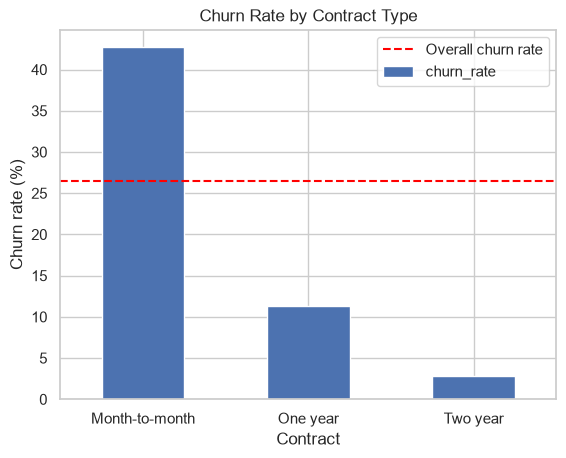
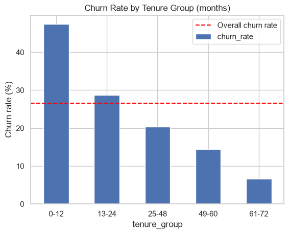
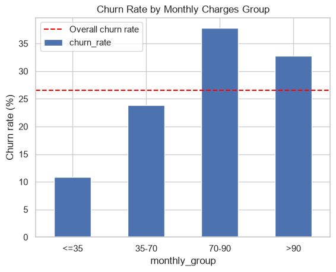

# Customer Churn Analysis (Python)

In this project, I analysed the IBM Telco Customer Churn dataset using Python to identify customer characteristics associated with churn. The analysis focuses on contract type, customer tenure, monthly charges, internet service, and additional services to identify customer segments that may require greater retention attention.

## Business Problem

I focused on four main questions to better understand customer churn:

1. Which customer segments have the highest churn rates?
2. How are contract type and customer tenure related to churn?
3. How do monthly charges and internet service relate to churn?
4. Are additional services associated with lower customer churn?

## Dataset

**Source:** IBM Telco Customer Churn dataset.

**Dataset size:** 7,043 customers and 21 columns.

The dataset contains customer information, including demographic attributes, subscribed services, contract details, monthly charges, total charges, tenure, and churn status.

The dataset is a single snapshot and does not contain dates, so the analysis focuses on differences between customer segments rather than changes over time.

## Tools

- Python
- pandas
- matplotlib
- seaborn
- Jupyter Notebook

Python was used for data preparation, data quality checks, exploratory analysis, and visualization. All analysis was performed in the notebook.

## Methodology and Definitions

| Item | Definition |
|---|---|
| Customers analysed | 7,043 customers |
| Churned customers | 1,869 customers |
| Overall churn rate | 26.54% |
| Churn rate | Percentage of customers in a segment whose churn status is Yes |
| Tenure groups | 0–12, 13–24, 25–48, 49–60, and 61–72 months |
| Monthly charge groups | ≤35, 35–70, 70–90, and >90 USD |
| Add-on analysis | Limited to 5,517 customers with internet service |
| Low-frequency subgroups | Groups with fewer than 120 customers were not interpreted |

Before analysing customer segments, I performed data quality checks covering data types, missing values, duplicate records, blank strings, and category consistency.

The preparation included:

- Converting `TotalCharges` to numeric values. The 11 blank values belonged to customers with zero tenure, so they were filled with 0.
- Standardizing `SeniorCitizen` values from 0/1 to No/Yes.
- Creating `Churn_flag` as a binary variable for calculating churn rates.
- Creating tenure and monthly charge groups for segment comparisons.
- Keeping "No internet service" and "No phone service" as separate categories from "No".

The original dataset was kept unchanged, with data preparation performed in a separate cleaned dataframe.

## Key Findings

Overall, **1,869 of 7,043 customers churned, representing 26.54%** of the customer base.

- **Contract type:** Month-to-month customers have a churn rate of 42.7%, compared with 11.3% for one-year contracts and 2.8% for two-year contracts. They account for 88.6% of all churners.
- **Customer tenure:** Customers in their first 12 months have a churn rate of 47.4% and represent 55.5% of all churners. The rate falls to 6.6% among customers with 61–72 months of tenure.
- **Monthly charges:** Churn increases from 10.9% among customers paying up to $35 to 37.8% in the $70–90 group, before declining to 32.8% above $90. This pattern is not linear and largely reflects differences in service mix.
- **Internet service:** Fiber optic customers have the highest churn rate at 41.9%, compared with 19.0% for DSL and 7.4% for customers without internet service. Fiber optic customers represent 44.0% of the customer base but 69.4% of churners.
- **Additional services:** Among internet customers, those without OnlineSecurity or TechSupport have churn rates of 41.8% and 41.6%, compared with 14.6% and 15.2% among customers with these services. Part of this difference is associated with contract type.
- **Combined factors:** Month-to-month customers in their first 12 months account for 28.3% of the customer base but 54.8% of all churners. Their churn rate is 51.4%.

These findings describe associations between customer characteristics and churn. They do not establish cause-and-effect relationships.

## Selected Results

**1. Churn Rate by Contract Type**

Compares churn rates across month-to-month, one-year, and two-year contracts, highlighting the substantial difference between contract types.



**2. Churn Rate by Customer Tenure**

Shows how churn rates vary across customer tenure groups, with a particular focus on the higher churn risk among newer customers.



**3. Churn Rate by Monthly Charges**

Compares churn rates across monthly charge groups to explore how customer spending relates to churn.



## Recommendations

Based on the findings, I identified several areas that could help improve customer retention:

- **Prioritize Early Retention:** Focus on new month-to-month customers through early engagement and incentives to consider longer-term contracts. This segment represents 54.8% of all churners.
- **Investigate Fiber Optic Churn:** Review customer feedback, service quality, and competitor pricing to better understand why Fiber optic customers have a substantially higher churn rate.
- **Test Additional Service Offers:** Pilot OnlineSecurity and TechSupport offers for month-to-month internet customers who do not currently subscribe to them. Use a control group to evaluate the results.
- **Deprioritize Streaming Add-ons:** StreamingTV and StreamingMovies show relatively weak associations with churn, with differences of around 3–4 percentage points.

These recommendations are hypotheses and should be tested through small pilot programs with control groups before being implemented more broadly.

## Limitations

Several limitations and assumptions should be considered when interpreting the results.

**Data and cleaning**

- The dataset is a single snapshot of 7,043 customers from the IBM Telco sample. It contains no dates, so trends over time and seasonality cannot be examined.
- The 11 blank `TotalCharges` values were replaced with 0. All 11 customers have zero tenure, indicating that they are new customers with no billing yet.
- "No internet service" and "No phone service" were kept as separate categories. Add-on analysis was limited to 5,517 customers with internet service, whose baseline churn rate was 31.8%.

**Method and interpretation**

- The analysis is descriptive. The observed relationships do not prove that any customer characteristic causes churn.
- Customer segments were compared using one or two variables at a time. Variables such as contract type, tenure, internet service, and monthly charges overlap, and no multivariate method was used to isolate the individual contribution of each factor.
- Monthly charge and tenure groups were defined manually. Different group boundaries could produce different patterns.
- Some subgroups contained fewer than 120 customers and were excluded from interpretation. Examples include Fiber optic customers in the $35–70 monthly charge group (112 customers) and two-year contract customers in the first 24 months of tenure (68 and 90 customers).
- OnlineBackup, DeviceProtection, StreamingTV, and StreamingMovies were not examined separately by internet type or contract type.
- Tenure was not controlled in the add-on service analysis. Customers who subscribe to additional services may differ from those who do not in other characteristics.
- Customers with long tenure are survivors: they have remained with the company. Their lower churn rates reflect customers who stayed, rather than necessarily indicating that long tenure itself prevents churn.
- The dataset does not include customer feedback, service quality, campaign costs, or revenue information. Therefore, the financial impact of the recommendations cannot be estimated.

## Possible Next Steps

Several areas could be explored further to strengthen the analysis:

- Apply statistical tests, such as chi-square tests, to assess the strength and statistical significance of the observed associations.
- Build a multivariate model, such as logistic regression, to examine the individual contribution of overlapping customer characteristics.
- Incorporate customer feedback, service quality, and pricing data to investigate the high churn rate among Fiber optic customers.
- Evaluate retention strategies through controlled experiments with appropriate control groups.

These improvements are outside the scope of the current descriptive analysis but could provide a stronger basis for future business decisions.

## Repository Structure

```text
customer-churn-analysis/
├── README.md
├── requirements.txt
├── .gitignore
├── data/
│   └── Telco-Customer-Churn.csv
├── notebooks/
│   └── customer_churn_analysis.ipynb
└── images/
    ├── churn_by_contract.png
    ├── churn_by_tenure.png
    └── churn_by_internet_service.png
```

## How to Reproduce

To explore the analysis or run the notebook yourself:

1. Download the IBM Telco Customer Churn dataset from the [IBM dataset repository](https://raw.githubusercontent.com/IBM/telco-customer-churn-on-icp4d/master/data/Telco-Customer-Churn.csv).
2. Save the CSV file as `data/Telco-Customer-Churn.csv`.
3. Create and activate a Python virtual environment.
4. Install the required dependencies:

   ```bash
   pip install -r requirements.txt
   ```

5. Open `notebooks/customer_churn_analysis.ipynb` in Jupyter Notebook or JupyterLab.
6. Run all cells in order.

## Author

Ruben

[LinkedIn](https://linkedin.com/in/rubenjohanno)
